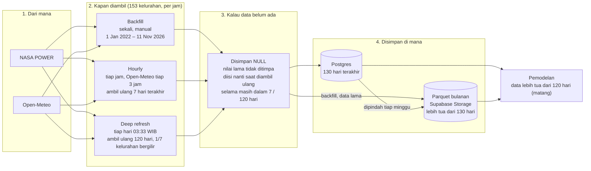
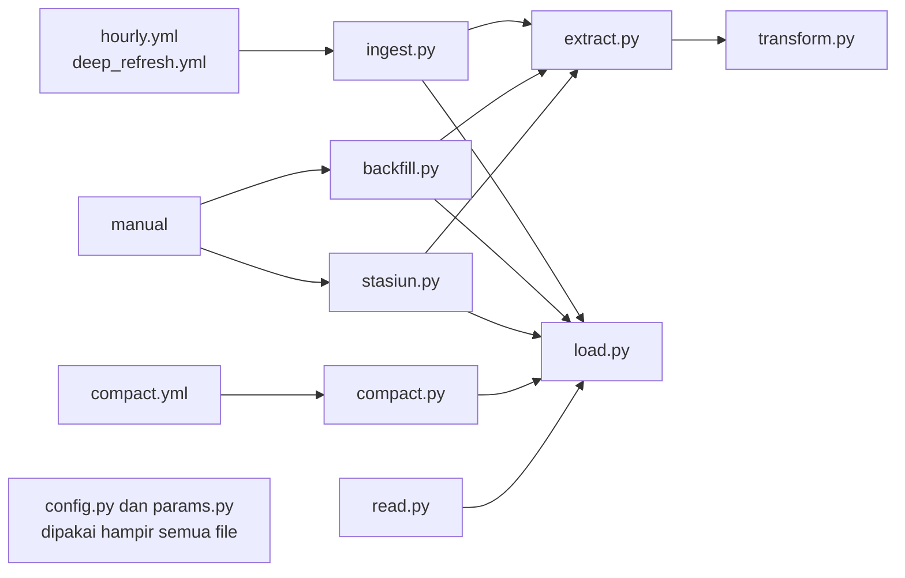

# ETL Data Cuaca Surabaya

## Deskripsi

Pipeline ini mengambil data cuaca per jam dari NASA POWER dan Open-Meteo untuk 153 kelurahan di Surabaya sejak 2022-01-01, merapikannya, lalu menyimpannya di Supabase: 130 hari terakhir di Postgres dan data yang lebih tua sebagai Parquet bulanan di Supabase Storage. Selain itu, pipeline mengambil data harian kedua sumber di titik 3 stasiun BMKG sebagai pembanding observasi BMKG. Semua waktu disimpan dan ditampilkan dalam WIB.

## Alur ETL



Data harian di 3 stasiun BMKG, untuk membandingkan kedua sumber dengan observasi BMKG:


Backfill mengisi riwayat sekali, sedangkan hourly dan deep refresh terus mengambil ulang beberapa hari terakhir, sehingga nilai yang terlambat atau direvisi sumber ikut masuk. Nilai yang belum ada di sumber (-999 atau NaN) disimpan sebagai NULL, dan nilai yang sudah tersimpan tidak pernah ditimpa oleh NULL. Data 130 hari terakhir ada di Postgres, sisanya di Parquet, dan pemodelan memakai gabungan keduanya yang sudah matang, yaitu lebih tua dari 120 hari karena tidak lagi direvisi sumber. Data harian stasiun memakai aturan nilai yang sama, tetapi hanya disimpan di Postgres.

## Alur file

Panah berarti "memanggil".



Pengendali memanggil `extract.py` untuk mengambil data lalu memanggil `load.py` sendiri untuk menyimpannya, jadi `transform.py` tidak memanggil `load.py`. `load.py` juga memakai `drop_all_null()` dan `coalesce_dupes()` dari `transform.py`, agar aturan NULL dan COALESCE sama saat menulis ke Postgres maupun Parquet. `load.py` bisa dijalankan langsung dengan `python -m pipeline.load` untuk mengisi ulang `ringkasan_arsip` dari semua Parquet di Storage, tanpa memanggil API cuaca. `read.py` diteruskan lewat `__init__.py`, sehingga cukup menulis `from pipeline import load_dataset, load_stasiun`.

| File | Peran | Dipanggil oleh |
|---|---|---|
| `ingest.py` | Pengendali: job `hourly` dan `deep_refresh` ke Postgres | `hourly.yml`, `deep_refresh.yml` |
| `backfill.py` | Pengendali: backfill hourly yang bisa dihentikan dan dilanjutkan | manual di laptop |
| `stasiun.py` | Pengendali: daily titik stasiun BMKG | manual |
| `compact.py` | Pengendali: memindahkan hourly lebih tua dari 130 hari ke Parquet | `compact.yml` |
| `extract.py` | Extract: memanggil API, retry, jeda, penghitung kuota Open-Meteo | `ingest.py`, `backfill.py`, `stasiun.py` |
| `transform.py` | Transform: JSON ke DataFrame, -999/NaN ke NULL, waktu ke WIB, buang waktu masa depan | `extract.py`, `load.py` |
| `load.py` | Load: Postgres (upsert COALESCE, `ingestion_log`), Parquet di Storage, `ringkasan_arsip` | semua pengendali, `read.py`; manual `python -m pipeline.load` |
| `read.py` | Pendukung: `load_dataset()` dan `load_stasiun()` | `__init__.py` |
| `__init__.py` | Pendukung: meneruskan `load_dataset()` dan `load_stasiun()` | `from pipeline import ...` |
| `config.py` | Pendukung: path, `.env`, konstanta, logging, kunci satu job | hampir semua file |
| `params.py` | Pendukung: parameter dan nama kolom bersatuan per tabel | semua file kecuali `config.py` |

## Tabel database

| Peran | Tabel | Sumber | Granularitas | Titik | Isi singkat |
|---|---|---|---|---|---|
| Data | `nasa_hourly` | NASA POWER | hourly | 153 kelurahan | 6 parameter, 130 hari terakhir; kunci `(kelurahan_id, waktu)` |
| Data | `openmeteo_hourly` | Open-Meteo | hourly | 153 kelurahan | 8 parameter (`visibility` dari Historical Forecast API), 130 hari terakhir |
| Data | Parquet `weather-archive/{sumber}/hourly/{YYYY}/{YYYY-MM}.parquet` | NASA POWER, Open-Meteo | hourly | 153 kelurahan | data lebih tua dari 130 hari, satu file per bulan WIB, zstd, nilai float32 |
| Juri | `nasa_daily_stasiun` | NASA POWER | daily | 3 stasiun BMKG | 8 parameter; `tanggal` dalam LST (waktu matahari lokal) |
| Juri | `openmeteo_daily_stasiun` | Open-Meteo | daily | 3 stasiun BMKG | 9 parameter; `tanggal` dalam WIB |
| Referensi | `kelurahan` | `koordinat_kelurahan_surabaya.csv` | – | 153 kelurahan | `kode_kel`, kecamatan, desa, koordinat, `metode_titik` (centroid atau polylabel) |
| Referensi | `stasiun_bmkg` | `koordinat_BMKG_surabaya.csv` dan respons API | – | 3 stasiun BMKG | koordinat, elevasi stasiun, elevasi titik grid NASA dan Open-Meteo |
| Catatan | `ingestion_log` | pipeline | – | – | satu baris per run atau potongan backfill: job, rentang, tujuan, status (`running`, `success`, `failed`, `skipped`, `superseded`, `aborted`) |
| Catatan | `ringkasan_arsip` | pipeline, dihitung dari Parquet | hourly | – | per sumber, bulan, dan parameter: jumlah baris, jumlah terisi, waktu awal dan akhir terisi |
| Pemantauan | `status_pengambilan_data` (view) | `ingestion_log`, tabel hourly | hourly | – | per sumber: run sukses terakhir, data terbaru, run gagal 24 jam terakhir, persen NULL 7 hari |
| Pemantauan | `status_data_parameter` (view) | tabel hourly, `ringkasan_arsip`, tabel daily stasiun | hourly, daily_stasiun | – | per sumber dan parameter: data mulai dan terakhir, jumlah baris, jumlah terisi, persen kosong |

## Penjadwalan

Rincian dari diagram [Alur ETL](#alur-etl).

| Workflow | Cron (UTC) | WIB | Lookback | Isi |
|---|---|---|---|---|
| `hourly.yml` | `7 * * * *` | tiap jam, menit ke-7 | 7 hari | NASA tiap jam; Open-Meteo hanya pada jam UTC kelipatan 3; semua 153 kelurahan |
| `deep_refresh.yml` | `33 20 * * *` | 03:33 setiap hari | 120 hari | kedua sumber untuk sekitar 22 kelurahan yang mendapat giliran hari itu |
| `compact.yml` | `43 21 * * 0` | Senin 04:43 | – | memindahkan hourly lebih tua dari 130 hari dari Postgres ke Parquet |

- **`SCHEDULE_ENABLED`**: run terjadwal hanya berjalan jika repository variable `SCHEDULE_ENABLED` bernilai `true`. Jika tidak, run tampil *skipped*. Jalan manual dari tab Actions (`workflow_dispatch`) selalu bisa.
- **Concurrency dan lock**: setiap workflow punya grup concurrency sendiri dengan `cancel-in-progress: false`, jadi run baru menunggu run sebelumnya dari workflow yang sama, bukan berjalan bersamaan. Di satu mesin, setiap job memegang kunci `_work/pipeline.lock` (`fcntl.flock`), dan job kedua langsung berhenti. Kunci ini tidak menjangkau runner GitHub.
- **Lookback 7 hari**: rentangnya dari 00:00 WIB enam hari lalu sampai jam yang sedang berjalan.
- **Deep refresh bergilir**: kelurahan dipilih dengan `kelurahan_id % 7 == tanggal_WIB.toordinal() % 7`. `toordinal()` terus bertambah melewati pergantian tahun, jadi gilirannya tidak rusak di awal tahun.
- **Compact**: batasnya 00:00 WIB (hari ini − 130 hari). Per bulan, data digabung ke Parquet, diunggah dan diverifikasi lewat `etag`, dicatat di `ringkasan_arsip`, dan baru setelah itu dihapus dari Postgres. Jika satu langkah gagal, baris di Postgres tetap ada.
- **Open-Meteo hourly tiap 3 jam**: hanya pada jam UTC 00, 03, 06, …, yaitu 07, 10, 13, 16, 19, 22, 01, dan 04 WIB, untuk menghemat kuota. Penghitung kuota lokal membatasi 9.000 per hari UTC, 4.500 per jam, dan 500 per menit. Jika kuota penuh atau API membalas HTTP 429, job berhenti tanpa menulis data dan run tampil gagal.
- **Upsert COALESCE**: `fetched_at` hanya berubah jika baris menerima nilai non-NULL baru yang berbeda.
- **Jadwal GitHub bersifat best effort**: run terjadwal bisa terlambat atau dilewati, terutama di awal jam; karena itu menitnya digeser ke :07, :33, dan :43. Celahnya ditutup oleh lookback. GitHub juga menonaktifkan jadwal repo publik yang tidak aktif selama 60 hari.
- **Backfill hanya manual**: `python -m pipeline.backfill` dijalankan di laptop, dan potongan yang sudah `success` dilewati. Jangan menjalankannya saat jadwal sedang memakai kuota Open-Meteo, karena penghitung kuota laptop dan runner GitHub tidak saling tahu sehingga total pemakaian bisa melewati batas asli.

## Tree

```
etl/
├── README.md                          dokumentasi ini
├── requirements.txt                   library Python
├── schema.sql                         tabel, indeks, RLS, dan view; dijalankan load.prepare() di awal setiap job
├── koordinat_kelurahan_surabaya.csv   153 titik kelurahan; nomor baris = kelurahan_id, urutannya jangan diubah
├── koordinat_BMKG_surabaya.csv        3 titik stasiun BMKG
├── .env                               DATABASE_URL, SUPABASE_URL, SUPABASE_SERVICE_ROLE_KEY (tidak masuk Git)
├── pipeline/
│   ├── __init__.py                    mengekspor load_dataset() dan load_stasiun()
│   ├── config.py                      path, .env, konstanta, logging, kunci satu job per mesin
│   ├── params.py                      parameter dan nama kolom bersatuan per tabel
│   ├── extract.py                     ambil data NASA POWER dan Open-Meteo, retry, penghitung kuota
│   ├── transform.py                   JSON ke DataFrame: NULL, WIB, buang waktu masa depan
│   ├── load.py                        Postgres, Parquet di Storage, ringkasan_arsip
│   ├── ingest.py                      job hourly dan deep_refresh
│   ├── backfill.py                    backfill hourly manual yang bisa dilanjutkan
│   ├── stasiun.py                     daily titik stasiun BMKG, manual
│   ├── compact.py                     pindahkan hourly lebih tua dari 130 hari ke Parquet
│   └── read.py                        load_dataset() dan load_stasiun() untuk pemodelan
└── _work/                             data kerja lokal (tidak masuk Git)
    ├── parquet_staging/               salinan persis file Storage sesudah unggahan terverifikasi
    ├── parquet_pending/               data backfill yang belum diunggah
    ├── openmeteo_budget.json          penghitung kuota Open-Meteo lokal
    ├── backfill.log                   log semua run backfill
    └── pipeline.lock                  kunci satu job per mesin
```
